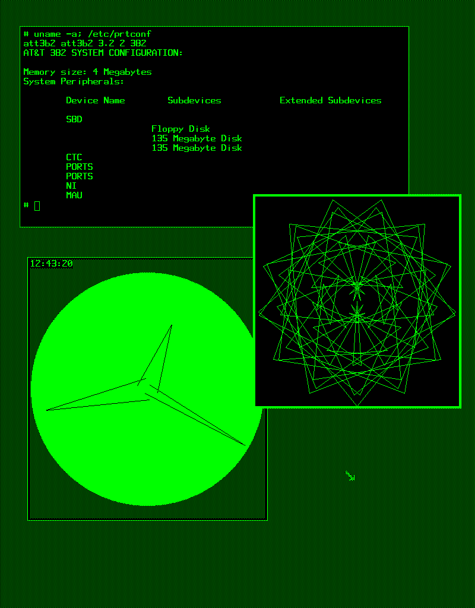
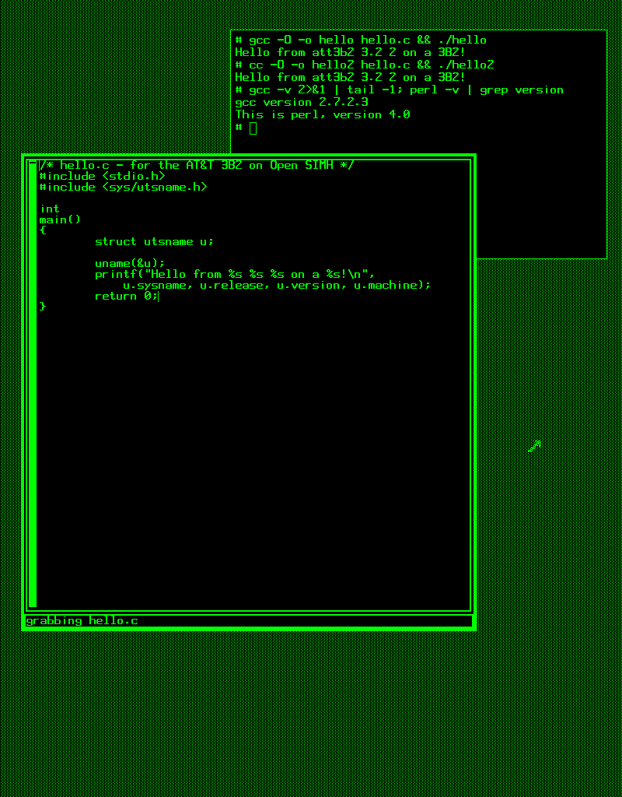
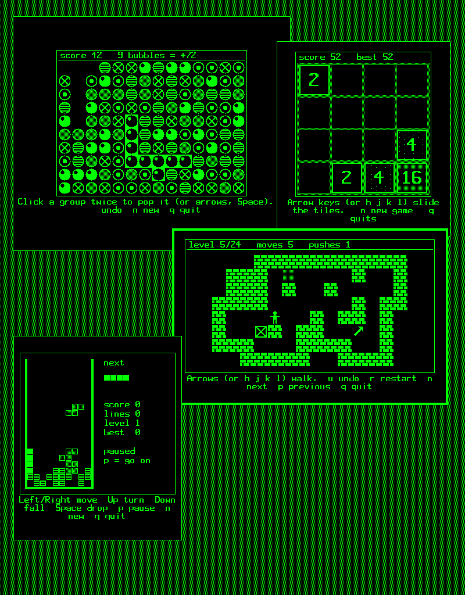
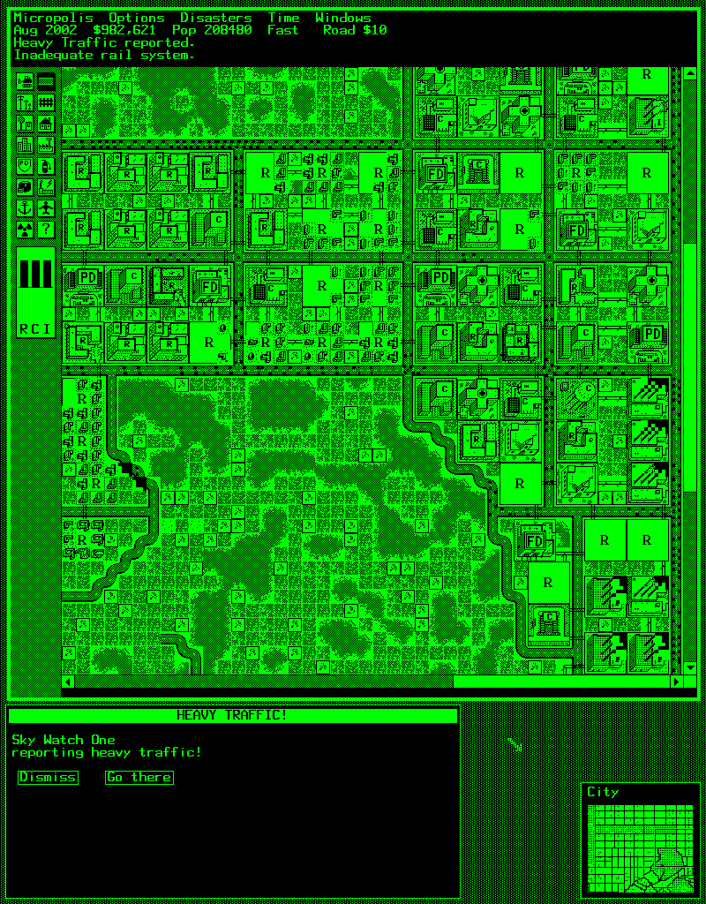

# DMD 5620 emulator

An emulator of the AT&T / Teletype DMD 5620, the commercial version of
the Bell Labs Blit: a bitmap terminal with an 800x1024 one-bit portrait
screen, a WE 32100 CPU, a keyboard and a three-button mouse. It runs the
original firmware, versions 8;7;3 and 8;7;5.

It runs on macOS, Linux, FreeBSD and Windows. It needs only SDL2.

It also has a built-in [MCP](https://modelcontextprotocol.io/) server, so
an AI agent can look at the screen and use the keyboard and the mouse.
See [MCP.md](MCP.md).

This is a fork of Seth Morabito's
[dmd_sdl](https://git.loomcom.com/seth/dmd_sdl). His emulator core,
[dmd_core](https://git.loomcom.com/seth/dmd_core), is written in Rust.
Here it is ported to plain C with the same C API (folder `core/`). A
test runs both cores side by side and compares them after every
instruction (see [Testing](#testing)). The C core is faster, and it has
one fix, so firmware 8;7;3 works too.

## Screenshots

The DMD 5620 with `layers` on an emulated AT&T 3B2/400 with UNIX System
V Release 3.2 ([Open SIMH](https://github.com/open-simh/simh)). A ready to
run kit with the 3B2 and this emulator:
[att3b2-400-svr32-simh.tar.lz](https://files.42718.net/mirror/tenox/os/att/3b2/att3b2-400-svr32-simh.tar.lz).

<table>
<tr>
<td><a href="screenshots/layers-demos.png"></a><br>layers: <code>uname</code> and <code>prtconf</code>, the rose and clock demos</td>
<td><a href="screenshots/jim.png"></a><br>jim, the DMD text editor, with gcc and AT&amp;T cc</td>
</tr>
<tr>
<td><a href="screenshots/games.png"></a><br>New games: Bubble Breaker, 2048, Sokoban and Falling Blocks (<a href="https://files.42718.net/mirror/tenox/os/att/3b2/games/">get them</a>)</td>
<td><a href="screenshots/micropolis.png"></a><br>Micropolis, the open source SimCity (<a href="https://github.com/tenox7/dmdcity">tenox7/dmdcity</a>)</td>
</tr>
</table>

## Download

Ready binaries are on the [Releases](../../releases) page:

| File | For |
|---|---|
| `dmd5620-VERSION-macos.dmg` | macOS 10.13 and later, Apple silicon and Intel: `DMD5620.app`, drag it to Applications |
| `dmd5620-VERSION-macos.zip` | The same for macOS, as a command line program |
| `dmd5620-VERSION-linux-x86_64.tar.gz` | Linux on x86_64 (needs the SDL2 package) |
| `dmd5620-VERSION-linux-arm64.tar.gz` | Linux on arm64 (needs the SDL2 package) |
| `dmd5620-VERSION-freebsd-amd64.tar.gz` | FreeBSD 14 on amd64 (needs `pkg install sdl2`) |
| `dmd5620-VERSION-windows-x64.zip` | Windows 10 and later, x64 (SDL2 is built in) |

The macOS, Linux and FreeBSD packages include `layers`, the DMD's window
system for your local shell. See [Windows with layers](#windows-with-layers).

## Use

```
dmd5620 [-f VER] [-n FILE] [--scale N] [--headless] [--name NAME] [--no-mcp]
        [-s SHELL | -d DEV [--baud N] | -t HOST[:PORT] | --tcp HOST:PORT]
```

The terminal must talk to a host. Give one of these:

| Option | Host |
|---|---|
| `-s SHELL`, `--shell` | A local shell on a pseudo terminal. This is the default, with your login shell. Not on Windows. |
| `-d DEV`, `--device` | A serial port: `/dev/ttyUSB0`, `/dev/cu.usbserial-1`, `COM3`. `--baud N` sets the speed (default 9600). |
| `-t HOST[:PORT]`, `--telnet` | A telnet server. The default port is 23. |
| `--tcp HOST:PORT` | A raw TCP connection, with no telnet protocol. |

Other options:

| Option | What it does |
|---|---|
| `-f VER`, `--firmware` | Firmware `"8;7;3"` or `"8;7;5"` (default) |
| `-n FILE`, `--nvram` | Keep the terminal's settings (its NVRAM) in FILE. Without a file, the terminal starts with the firmware's defaults, but at 19200 baud |
| `-i`, `--inherit` | Give the shell your whole environment, not a small clean one |
| `--scale N` | Window size 1, 2, 3 or 4; 1 is 800x1024, pixel for pixel (default). The window has a fixed size |
| `--headless` | No window. MCP still sees the screen |
| `--name NAME` | Name of this terminal in the MCP tools |
| `--no-mcp` | No MCP control socket |

Examples:

```
dmd5620 -n ~/.dmd5620_nvram
dmd5620 -f "8;7;3" -d /dev/ttyS0 --baud 19200
dmd5620 -t localhost:9100
```

### Windows with layers

`layers` is the host side of the DMD's window system. With it, the DMD
shows many windows, each with its own shell. dmd5620 includes `layers` for
macOS, Linux and FreeBSD. It is the pseudo-tty version by Keith Muller and
Dave Dykstra (public domain), ported to current systems:
[tenox7/dmd-layers](https://github.com/tenox7/dmd-layers). Firmware 8;7;5
(the default) has the window system in ROM, so nothing is downloaded to
the terminal. Firmware 8;7;3 is not tested.

1. Start `dmd5620` with a local shell (the default).
2. Type `layers`. After about 5 seconds the screen turns grey.
3. Make a window: hold the right mouse button, move to **New**, release.
   Then press the right button at one corner, move to the other corner,
   and release. A shell starts in the window.
4. Click a window with the left button to type in it.
5. The right button menu also has **Reshape**, **Move**, **Top**,
   **Bottom**, **Current**, **Delete** and **Exit**.
6. To stop layers, choose **Exit** and click to confirm, or type `exit` in
   the last window.

In the windows you can use these programs: `jwin` (window size), `ismpx`
(am I in layers?), `xts` and `xtt` (protocol statistics and trace),
`relogin`, `pfkey`, `plabel`, `pmenu`, `penter`, `jterm`. Their man pages
are in `layers/man`.

When dmd5620 starts a shell and finds its `layers` folder, it adds
`layers/bin` to the shell's `PATH`, and sets `DMDSYS` (the `layers`
folder) and `DMD` (a private folder for the pipes of `layers`, in
`$XDG_RUNTIME_DIR`, `$TMPDIR` or `/tmp`). It does not change a `DMD` or
`DMDSYS` that you set.

| Package | The `layers` folder |
|---|---|
| `DMD5620.app` | `DMD5620.app/Contents/Resources/layers` |
| zip, tar.gz | `layers` next to `dmd5620` |
| `make install` | `PREFIX/lib/dmd5620/layers` |
| Source | `make layers` puts it in `layers` next to `dmd5620` |

Notes:

- Speed: layers is very slow at 1200 baud. New terminals start at 19200.
  An NVRAM file from version 0.2.2 or older may have 1200: press F9
  (Setup), then **Port Options**, **Port A Options**, and **Speed** until
  it shows 19200.
- `layers: not found`: your shell profile (for example FreeBSD's default
  `~/.profile`) sets a new `PATH`. Add this line after it:
  `[ -n "$DMDSYS" ] && PATH="$PATH:$DMDSYS/bin"`
- **Delete** in the menu does nothing. Type `exit` in the window to close
  it.
- `who` does not show the windows: `layers` cannot write the login records
  without root.

### Demos: programs that run in the DMD

The host can send a program into a layers window. The DMD's own CPU then
runs it in that window. `32ld` does this. dmd5620 includes `32ld`, ported
from the AT&T 5620 development package
([tenox7/dev5620](https://github.com/tenox7/dev5620)), and the demos and
tools from the AT&T DMD Core Utilities diskettes.

In a layers window:

| Command | What it does |
|---|---|
| `demo` | Lists the demos |
| `demo rose` | Runs a demo. Most end with `q`. |
| `lens` | A magnifying glass: it shows the screen under the mouse |
| `hp2621` | Makes the window an HP 2621 terminal |
| `tek4014` | Makes the window a Tektronix 4014 terminal (graphics) |
| `32ld FILE` | Loads any DMD program for layers |

The demos: a, b, ball, bounce, calc, clock, clock1, clock2, dmdlock,
doodle, juggle, m, maxwell, memory, nball, rae, rose, scope, weird, worm.

Notes:

- A demo takes the keyboard a second or two after it starts to draw.
  Keys typed before that go to the shell. If `q` does not end the demo,
  type it again.
- `lens` does not end with `q`. Close its window with **Delete** or start
  another program in it.
- `dmdlock` locks the terminal: type a password, then the same password
  again to unlock.
- `memory` makes its window very small.
- `life` is not included: its host part is a 3B2 program.

### Connect to a 3B2

The [OpenSIMH 3B2 emulator](https://loomcom.com/3b2/emulator/) gives its
serial lines as telnet ports. In the 3B2 emulator:

```
ATTACH CONTTY 9100
```

Then connect the DMD to it:

```
dmd5620 -t localhost:9100
```

A real 3B2 or other Unix host can use a serial port (`-d`), or telnet
(`-t`). The emulator tells a telnet server that its terminal type is `DMD`
and its size is 88x70.

### Mouse

The DMD cursor follows the host pointer pixel for pixel. The DMD mouse is
relative, so the emulator sends the difference between the pointer and
the cursor, and corrects it with the firmware's own cursor position when
the mouse rests.

### Keys

| Key | DMD key |
|---|---|
| F1 to F8 | F1 to F8 |
| F9 | Setup (the window title says so too) |
| Shift+F9 | Reset |
| Cmd+V (Mac), Shift+Insert, Ctrl+Shift+V | Paste the clipboard as typed text |

Press F9 (Setup) to change the settings: baud rate, screen colors, key
click, and more. In firmware 8;7;3 use Tab or Backspace to move and Space
to change a value. In firmware 8;7;5 use the function keys or the mouse.

The shell gets `TERM=dmd`. Most terminfo databases have a `dmd` entry.

The DMD manuals are at
[archives.loomcom.com](https://archives.loomcom.com/3b2/documents/DMD_Terminal/).
More about the original emulator is at
[loomcom.com](https://loomcom.com/3b2/dmd5620-emulator/).

## Build

You need a C99 compiler, GNU make, pkg-config and SDL2.

| System | Packages | Build |
|---|---|---|
| macOS | `brew install sdl2 pkg-config` | `make` |
| Debian, Ubuntu | `apt install build-essential pkg-config libsdl2-dev` | `make` |
| Fedora | `dnf install gcc make pkgconf SDL2-devel` | `make` |
| FreeBSD | `pkg install gmake pkgconf sdl2` | `gmake` |
| Windows (MSYS2 UCRT64) | `pacman -S make mingw-w64-ucrt-x86_64-gcc mingw-w64-ucrt-x86_64-SDL2` | `make` |

`make install` puts the program, the man page, the icons and the desktop
file under `/usr/local` (set `PREFIX` for another place).

`make layers` builds `layers` from the git submodule `dmd-layers`, and
`32ld` with the demos from the git submodule `dev5620` (it gets the
submodules if they are not there), into `layers/`. Do it before
`make install` to install them too. Not for Windows.

Other make settings:

- `make STATIC=1` links SDL2 statically.
- `make SDL_CONFIG=/path/to/sdl2-config` uses that SDL2 and not the one
  pkg-config finds.
- `make CC=x86_64-w64-mingw32-gcc SDL_CONFIG=...` builds `dmd5620.exe`
  on Linux or macOS with MinGW-w64 and the SDL2 MinGW package
  (`SDL2-devel-2.x.x-mingw.tar.gz`).

## Testing

`test/smoke.py ./dmd5620` and `test/stress.py ./dmd5620` run the emulator
headless and use it through MCP. `test/layers.py ./dmd5620` starts
`layers`, opens a window with the mouse, runs `jwin`, `ismpx` and `xts`
in it, and loads `demo rose` into the DMD. CI runs these on macOS, Linux, FreeBSD and Windows (no
layers there).

`test/difftest/run.sh` checks the C core against the Rust core. It gets
dmd_core 0.7.2, adds the test hooks in `test/difftest/rust_core.patch`,
and builds both into one program. Then it runs random instruction streams
and boots both firmware versions. After every instruction it compares the
registers and the I/O; it compares all memory every 65536 instructions.
It needs git, cargo (Rust) and a C compiler.

## Notes

- Firmware 8;7;3 works here. In the Rust core it stops at "I/O TEST":
  its DUART does not receive a break in loopback mode as a 2681 does, so
  the power-on self test repeats forever. The C core has this fix;
  `dmd_set_rust_compat(1)` turns it off.
- On Windows there is no local shell, because Windows consoles do not
  speak the DMD's terminal codes. Use telnet or a serial port.

## License

MIT. See [LICENSE.md](LICENSE.md).

- Copyright 2018-2025 Seth J. Morabito: the original emulator and the
  Rust core.
- Copyright 2026 the dmd5620 authors: the C core and the changes in this
  fork.

The firmware ROM images in `core/rom.c` come from dmd_core.
